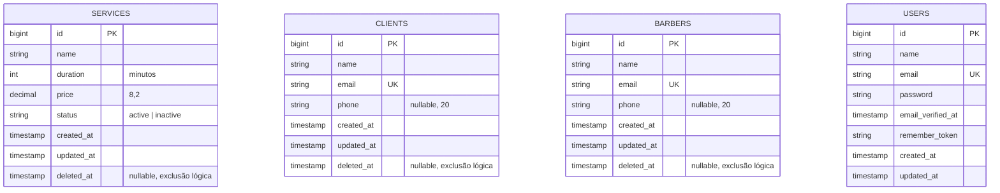
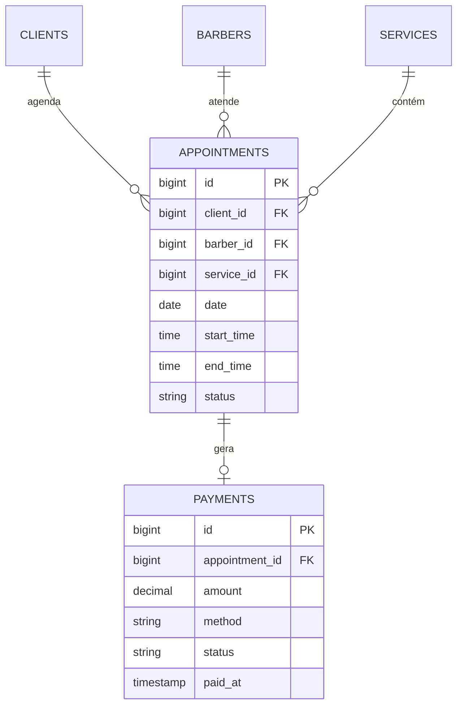

# Arquitetura do BarberFlow

Projeto da disciplina **Arquitetura de Microsserviços e Desenvolvimento de APIs**.
Equipe: Eduardo Romano, Jose Coene, Leonam e Manoel.

## 1. Visão geral

O BarberFlow é uma plataforma de gestão e agendamento para barbearias. O foco do produto é ajudar a barbearia a preencher horários vazios, reduzir faltas, aumentar a recorrência de clientes e acompanhar o faturamento.

Nesta etapa o sistema é uma **API REST monolítica modular** em Laravel: um único serviço com camadas bem separadas (rotas, controllers, models, banco). Essa escolha mantém o MVP simples e robusto, e deixa a base pronta para, no futuro, evoluir para um SaaS multiempresa.

## 2. Stack

| Camada | Tecnologia | Motivo |
|---|---|---|
| Backend / API | Laravel 13 (PHP 8.4.1+) | Roteamento de API, validação e ORM prontos; estrutura MVC alinhada ao esboço inicial |
| Banco de dados | MySQL | Banco relacional, adequado a agenda, clientes e financeiro |
| ORM | Eloquent | Evita SQL manual e facilita relacionamentos futuros |
| Autenticação | Laravel Sanctum (instalado, ainda não ativado) | Tokens de API com controle por perfil |
| Testes | PHPUnit (testes de feature) | Valida os endpoints de ponta a ponta |

## 3. Fluxo de uma requisição

```
Cliente HTTP (Postman, navegador, app)
        │
        ▼
routes/api.php            → Route::apiResource(...) mapeia verbo + URL para o controller
        │
        ▼
Controller                → valida o corpo e os filtros da requisição ($request->validate)
        │
        ▼
Model (Eloquent)          → lê/grava no MySQL (sem as linhas excluídas)
        │
        ▼
Resposta JSON             → 200, 201, 204, 404, 405, 422 ou 503
```

Padrões adotados:

- **`Route::apiResource`**: gera as 5 rotas REST de cada recurso com uma única linha.
- **Route model binding**: os métodos `show`, `update` e `destroy` recebem o model já carregado (ex.: `Service $service`). Se o ID não existe ou foi excluído, a API responde `404` com `{"message": "Registro não encontrado."}`.
- **Validação nos controllers**: regras declaradas em `$request->validate(...)`. Falhas retornam `422` com a lista de erros por campo, em português.
- **Limites iguais aos do banco**: `name` e `email` até 255 caracteres, `phone` até 20, `duration` de 5 a 480 minutos e `price` até 999999.99 (o máximo do `decimal(8,2)`). Assim um valor grande demais vira `422`, e não um erro 500 do MySQL.
- **Mesmo estilo nos três controllers**: `store` devolve `201` com o registro, `show` e `update` devolvem o registro e `destroy` devolve `204` sem corpo.
- **Listagens paginadas**: `index` devolve uma página por vez, em ordem de nome, com `page` (1 a 100000), `per_page` (1 a 100, padrão 15) e `search`. Serviços aceitam também `status`. A resposta tem `data` (itens), `links` (primeira, última, anterior e próxima página) e `meta` (página atual, última página, total etc.), montada pelo `JsonResource::collection()` do Laravel, sem classe de Resource própria. O teto do `page` existe porque a conta do offset (`(page - 1) * per_page`) estoura o inteiro do PHP com uma página enorme e viraria erro 500.
- **Respostas sempre em JSON** para qualquer rota `api/*` (configurado em `bootstrap/app.php`). Lá também ficam as mensagens de `404` (registro ou rota inexistente) e `405` (método errado) em português, sem o nome da classe do model que o Laravel colocaria na mensagem.
- **Mass assignment protegido**: cada model declara `$fillable` com os campos permitidos.
- **Casts no model**: `Service` converte `duration` para inteiro e `price` para texto com 2 casas (`"35.00"`), então o JSON sai igual no SQLite e no MySQL.

### Idioma e fuso horário

- **Português do Brasil:** `APP_LOCALE=pt_BR`. As mensagens de validação, autenticação, senha e paginação ficam em `lang/pt_BR/` e as frases soltas do framework em `lang/pt_BR.json`, escritas à mão a partir dos arquivos em inglês do Laravel. O bloco `attributes` do `validation.php` troca o nome técnico do campo pelo nome em português (`name` vira "nome"). O inglês continua como reserva (`APP_FALLBACK_LOCALE=en`).
- **Fuso de São Paulo:** `APP_TIMEZONE`, com padrão `America/Sao_Paulo` em `config/app.php`. O `now()` do PHP e as datas gravadas no banco usam a hora de Brasília, e o JSON entrega as datas em UTC (ISO 8601 com `Z`), que qualquer cliente converte. A agenda (horários de atendimento) depende desse fuso.

### Saúde da aplicação

| Rota | O que confere | Quem usa |
|---|---|---|
| `GET /up` | só que o PHP responde | o balanceador de carga e o Auto Scaling (health check do ALB) |
| `GET /api/health` | banco (`select 1`) e cache (grava e lê uma chave) | monitoramento, deploy, testes de carga e de resiliência |

O `/up` continua raso de propósito: se ele dependesse do banco, uma queda do banco faria o Auto Scaling trocar instâncias que estão boas, sem parar. O `/api/health` responde `200` com `{"status":"ok"}` ou `503` dizendo qual conferência falhou, só com `ok` ou `falhou`; o motivo vai para o log, nunca para a resposta. Ele também fica fora do limite de requisições da API (`withoutMiddleware('throttle:api')`), para o monitoramento e o deploy não receberem `429` quando o limite for ligado.

## 4. Estrutura de pastas

```
app/
  Http/Controllers/
    ServiceController.php
    ClientController.php
    BarberController.php
    HealthController.php   # GET /api/health
  Models/
    Service.php
    Client.php
    Barber.php
    User.php
    Concerns/
      ReleasesEmailOnDelete.php  # e-mail removido+{id}@barberflow.invalid de quem é excluído
bootstrap/app.php          # roteamento e tratamento de erros em JSON (404 e 405 em português)
database/
  migrations/              # definição das tabelas
  seeders/ServiceSeeder.php
lang/
  pt_BR/                   # mensagens de validação, auth, senha e paginação
  pt_BR.json               # frases soltas do framework
routes/api.php             # rotas da API
tests/Feature/             # testes dos endpoints
docs/                      # documentação
```

## 5. Modelo de dados atual

Tabelas de domínio implementadas:



Tabelas de infraestrutura do Laravel: `password_reset_tokens`, `sessions`, `cache`, `cache_locks`, `jobs`, `job_batches`, `failed_jobs` e `personal_access_tokens` (Sanctum).

Por enquanto as tabelas de domínio ainda não se relacionam entre si; os relacionamentos entram com a agenda.

### Histórico e LGPD (exclusão lógica)

`services`, `clients` e `barbers` usam *soft delete* (migration `add_soft_deletes_to_domain_tables` e o trait `SoftDeletes` nos models). O `DELETE` só preenche `deleted_at`: a linha continua no banco, para os agendamentos e pagamentos antigos continuarem apontando para ela, e some das listagens e das consultas por ID.

| Tabela | O que acontece no `DELETE` | Por quê |
|---|---|---|
| `clients` | nome vira "Cliente removido", e-mail vira `removido+{id}@barberflow.invalid` e telefone fica nulo (`Client::anonymizeAndDelete()`) | LGPD: o histórico fica, mas sem dado que identifique a pessoa |
| `barbers` | e-mail vira `removido+{id}@barberflow.invalid` e telefone fica nulo; o nome fica (`Barber::releaseEmailAndDelete()`) | o histórico precisa mostrar quem atendeu; o telefone não tem mais uso depois da exclusão (LGPD) |
| `services` | nada muda além do `deleted_at` | não há dado pessoal |

A troca do e-mail acontece na mesma transação da exclusão e libera o e-mail original no índice `unique` do banco: a pessoa pode ser cadastrada de novo. A regra `unique:tabela,email,{id}` da validação continua a mesma. O domínio `.invalid` é reservado (RFC 2606), então nenhum lembrete chega a um cadastro excluído por engano. A validação recusa e-mails `@barberflow.invalid` no cadastro e na edição: sem isso, alguém poderia cadastrar antes o endereço `removido+{id}` de outra pessoa e travar a exclusão dela num erro 500.

A validação sozinha não fecha essa porta no MySQL. A collation `utf8mb4_unicode_ci` compara sem diferenciar acento, então `removido+1@barberflow.ínvalid` passa no `not_regex` e, para o índice `unique`, é igual a `removido+1@barberflow.invalid` (o mesmo vale para a ligadura `fl` e as letras largas, como `ｉ`). Por isso o endereço sai do trait `App\Models\Concerns\ReleasesEmailOnDelete`: antes de gravar, ele pergunta ao banco se o endereço já está em uso, e o banco compara do mesmo jeito que o índice. Se estiver, a exclusão usa `removido+{id}.{sufixo aleatório}@barberflow.invalid` e termina normalmente. O teste simula a colisão gravando o endereço reservado direto no banco, porque o SQLite dos testes compara letra por letra.

### Modelo planejado (próximas sprints)



### Diferenças em relação ao esboço inicial

O esboço de arquitetura previa campos mais completos. Para o MVP, a equipe implementou o mínimo necessário para validar a API:

| Tabela | Previsto no esboço | Implementado | Observação |
|---|---|---|---|
| `barbers` | `user_id`, `phone`, `commission_rate`, `status` | `name`, `email`, `phone` | Vínculo com `users`, comissão e status ficam para quando houver autenticação e financeiro |
| `clients` | `name`, `phone`, `email`, `birth_date`, `notes` | `name`, `email`, `phone` | `birth_date` e `notes` podem entrar junto com fidelidade e histórico |
| `services` | `name`, `duration`, `price`, `status` | igual | Implementado como previsto |

## 6. Plano de entrega

| Sprint | Escopo | Situação |
|---|---|---|
| 1 | Ambiente, migrations, CRUD de `services` | Entregue |
| 2 | CRUD de `clients` e `barbers`, testes de feature, paginação e busca, exclusão lógica com anonimização, mensagens em pt-BR, fuso de São Paulo e `/api/health` | Entregue no código; autenticação por perfil (Sanctum) pendente |
| 3 | Agenda e agendamento online (consulta de horários livres) | Planejada |
| 4 | Status do atendimento, pagamentos, dashboard básico, documentação final | Planejada |

Prioridades do produto (do esboço inicial): login e cadastros-base (alta) → agenda e agendamento online (alta) → status de atendimento, pagamentos e dashboard (média) → lembretes, fidelidade e relatórios avançados (baixa).

## 7. Limitações e riscos conhecidos

- **Sem autenticação nem autorização:** todos os endpoints são públicos. Prioridade antes de qualquer uso real.
- **Página de até 100 itens:** as listagens não devolvem tudo de uma vez. Telas que precisam da lista inteira (como o Agendar) carregam os 100 primeiros em ordem de nome.
- **Busca simples:** `search` usa `LIKE '%texto%'`, que não aproveita índice. Serve para o volume de uma barbearia; com muitos milhares de cadastros, vale um índice de texto completo.
- **Validação nos controllers:** funciona bem no MVP; ao crescer, vale migrar para *Form Requests* e *API Resources* próprias para padronizar entrada e saída. Hoje só a paginação passa pelo `JsonResource::collection()`, que já entrega o formato `data`/`links`/`meta`; os itens saem como o model.
- **Sem desfazer exclusão:** a exclusão é lógica, mas não há rota para restaurar. No cliente, os dados pessoais já foram apagados e não voltam.
- **Datas antigas no banco local:** quem tinha dados gravados antes da troca do fuso (o padrão era UTC) vê esses horários deslocados em 3 horas. Não afeta dados novos.
- **Compatibilidade com PHP 8.5:** a versão é recente e alguns pacotes de terceiros podem ainda não suportá-la; conferir antes de adicionar dependências.

## 8. Evolução futura

Após o MVP: lembretes e confirmação por mensagem, programa de fidelidade, relatórios, aplicativo mobile e, a longo prazo, transformação em SaaS multiempresa (várias barbearias na mesma plataforma), integração oficial com WhatsApp e pagamentos online.
