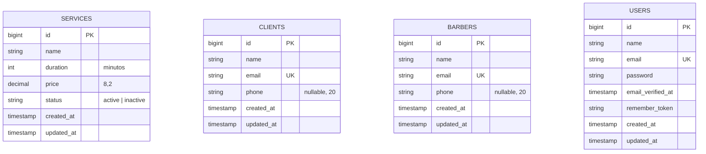
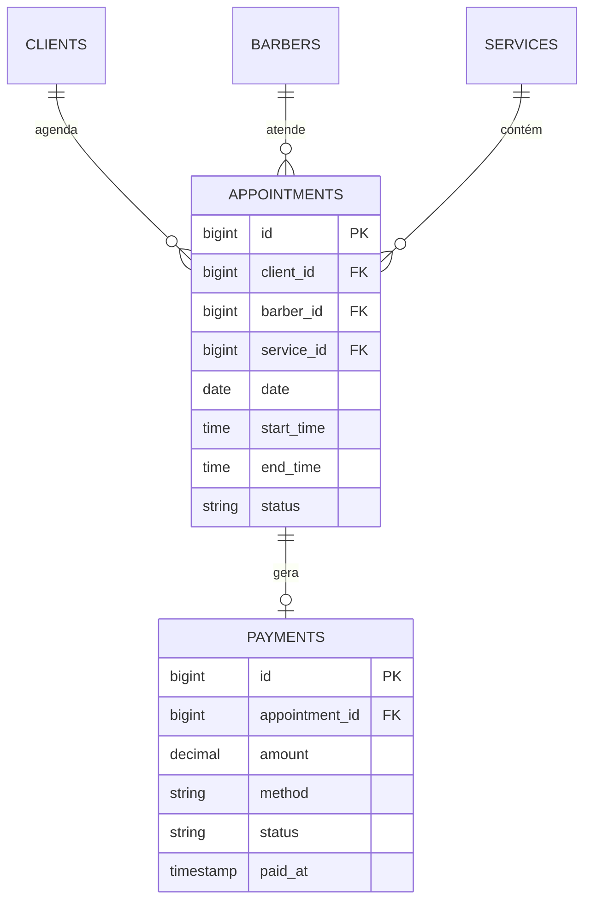

# Arquitetura — BarberFlow

Projeto da disciplina **Arquitetura de Microsserviços e Desenvolvimento de APIs**.
Equipe: Eduardo Romano, Jose Coene, Leonam e Manoel.

## 1. Visão geral

O BarberFlow é uma plataforma de gestão e agendamento para barbearias. O foco do produto é ajudar a barbearia a preencher horários vazios, reduzir faltas, aumentar a recorrência de clientes e acompanhar o faturamento.

Nesta etapa o sistema é uma **API REST monolítica modular** em Laravel: um único serviço com camadas bem separadas (rotas, controllers, models, banco). Essa escolha mantém o MVP simples e robusto, e deixa a base pronta para, no futuro, evoluir para um SaaS multiempresa.

## 2. Stack

| Camada | Tecnologia | Motivo |
|---|---|---|
| Backend / API | Laravel 13 (PHP 8.3+) | Roteamento de API, validação e ORM prontos; estrutura MVC alinhada ao esboço inicial |
| Banco de dados | MySQL | Banco relacional, adequado a agenda, clientes e financeiro |
| ORM | Eloquent | Evita SQL manual e facilita relacionamentos futuros |
| Autenticação | Laravel Sanctum (instalado, ainda não ativado) | Tokens de API com controle por perfil |
| Testes | PHPUnit (testes de feature) | Valida os endpoints de ponta a ponta |

## 3. Fluxo de uma requisição

```
Cliente HTTP (Postman, navegador, app)
        │
        ▼
routes/api.php            → Route::apiResource(...) mapeia verbo + URL para o controller
        │
        ▼
Controller                → valida o corpo da requisição ($request->validate)
        │
        ▼
Model (Eloquent)          → lê/grava no MySQL
        │
        ▼
Resposta JSON             → 200, 201, 204, 404 ou 422
```

Padrões adotados:

- **`Route::apiResource`**: gera as 5 rotas REST de cada recurso com uma única linha.
- **Route model binding**: os métodos `show`, `update` e `destroy` recebem o model já carregado (ex.: `Service $service`). Se o ID não existe, o Laravel responde `404` automaticamente.
- **Validação nos controllers**: regras declaradas em `$request->validate(...)`. Falhas retornam `422` com a lista de erros por campo.
- **Respostas sempre em JSON** para qualquer rota `api/*` (configurado em `bootstrap/app.php`).
- **Mass assignment protegido**: cada model declara `$fillable` com os campos permitidos.

## 4. Estrutura de pastas

```
app/
  Http/Controllers/
    ServiceController.php
    ClientController.php
    BarberController.php
  Models/
    Service.php
    Client.php
    Barber.php
    User.php
bootstrap/app.php          # roteamento e tratamento de erros em JSON
database/
  migrations/              # definição das tabelas
  seeders/ServiceSeeder.php
routes/api.php             # rotas da API
tests/Feature/             # testes dos endpoints
docs/                      # documentação
```

## 5. Modelo de dados atual

Tabelas de domínio implementadas:



Tabelas de infraestrutura do Laravel: `password_reset_tokens`, `sessions`, `cache`, `cache_locks`, `jobs`, `job_batches`, `failed_jobs` e `personal_access_tokens` (Sanctum).

Por enquanto as tabelas de domínio ainda não se relacionam entre si; os relacionamentos entram com a agenda.

### Modelo planejado (próximas sprints)



### Diferenças em relação ao esboço inicial

O esboço de arquitetura previa campos mais completos. Para o MVP, a equipe implementou o mínimo necessário para validar a API:

| Tabela | Previsto no esboço | Implementado | Observação |
|---|---|---|---|
| `barbers` | `user_id`, `phone`, `commission_rate`, `status` | `name`, `email`, `phone` | Vínculo com `users`, comissão e status ficam para quando houver autenticação e financeiro |
| `clients` | `name`, `phone`, `email`, `birth_date`, `notes` | `name`, `email`, `phone` | `birth_date` e `notes` podem entrar junto com fidelidade e histórico |
| `services` | `name`, `duration`, `price`, `status` | igual | Implementado como previsto |

## 6. Plano de entrega

| Sprint | Escopo | Situação |
|---|---|---|
| 1 | Ambiente, migrations, CRUD de `services` | Entregue |
| 2 | CRUD de `clients` e `barbers`, testes de feature | Entregue no código; autenticação por perfil (Sanctum) pendente |
| 3 | Agenda e agendamento online (consulta de horários livres) | Planejada |
| 4 | Status do atendimento, pagamentos, dashboard básico, documentação final | Planejada |

Prioridades do produto (do esboço inicial): login e cadastros-base (alta) → agenda e agendamento online (alta) → status de atendimento, pagamentos e dashboard (média) → lembretes, fidelidade e relatórios avançados (baixa).

## 7. Limitações e riscos conhecidos

- **Sem autenticação nem autorização:** todos os endpoints são públicos. Prioridade antes de qualquer uso real.
- **Sem paginação:** `GET` das listagens retorna todos os registros.
- **Validação nos controllers:** funciona bem no MVP; ao crescer, vale migrar para *Form Requests* e *API Resources* para padronizar entrada e saída.
- **Exclusão definitiva:** não há *soft delete*; ao existirem agendamentos, remover cliente/barbeiro/serviço exigirá tratar o histórico.
- **Compatibilidade com PHP 8.5:** a versão é recente e alguns pacotes de terceiros podem ainda não suportá-la; conferir antes de adicionar dependências.

## 8. Evolução futura

Após o MVP: lembretes e confirmação por mensagem, programa de fidelidade, relatórios, aplicativo mobile e, a longo prazo, transformação em SaaS multiempresa (várias barbearias na mesma plataforma), integração oficial com WhatsApp e pagamentos online.
