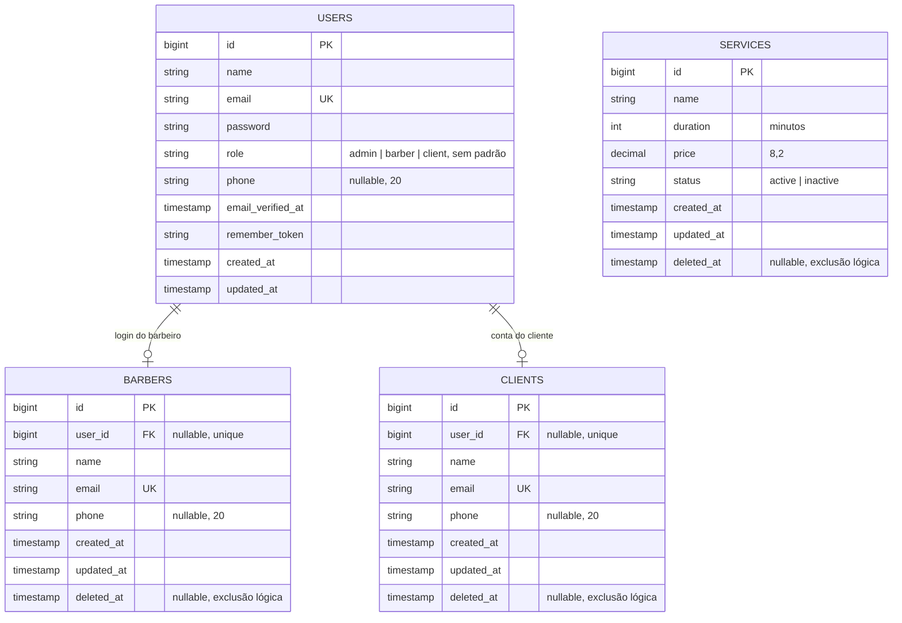
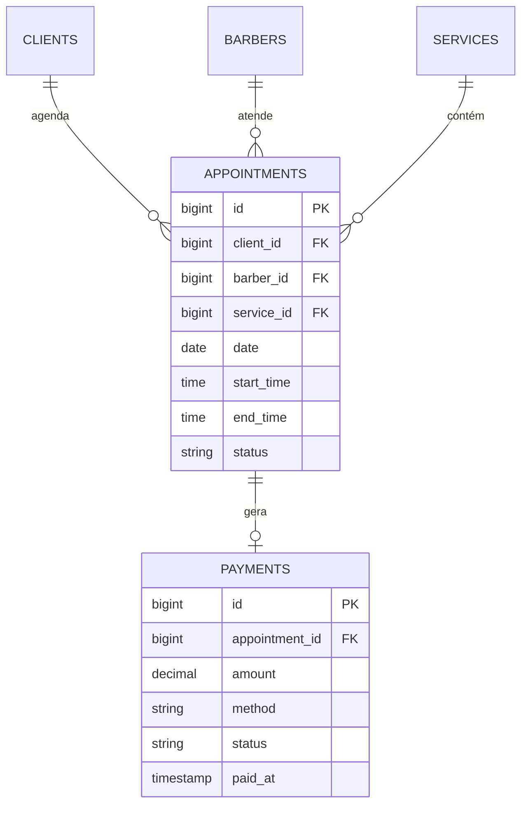

# Arquitetura do BarberFlow

Projeto da disciplina **Arquitetura de Microsserviços e Desenvolvimento de APIs**.
Equipe: Eduardo Romano, Jose Coene, Leonam e Manoel.

## 1. Visão geral

O BarberFlow é uma plataforma de gestão e agendamento para barbearias. O foco do produto é ajudar a barbearia a preencher horários vazios, reduzir faltas, aumentar a recorrência de clientes e acompanhar o faturamento.

Nesta etapa o sistema é uma **API REST monolítica modular** em Laravel: um único serviço com camadas bem separadas (rotas, controllers, models, banco). Essa escolha mantém o MVP simples e robusto, e deixa a base pronta para, no futuro, evoluir para um SaaS multiempresa.

## 2. Stack

| Camada | Tecnologia | Motivo |
|---|---|---|
| Backend / API | Laravel 13 (PHP 8.4.1+) | Roteamento de API, validação e ORM prontos; estrutura MVC alinhada ao esboço inicial |
| Banco de dados | MySQL | Banco relacional, adequado a agenda, clientes e financeiro |
| ORM | Eloquent | Evita SQL manual e facilita relacionamentos futuros |
| Autenticação | Laravel Sanctum | Sessão (cookie + CSRF) para as telas e token Bearer para a API, no mesmo pacote e com as mesmas regras de perfil |
| Telas | Blade + Bootstrap 5.3 via Vite | Telas servidas pelo próprio Laravel, que chamam a API com a sessão do navegador |
| Testes | PHPUnit (testes de feature) | Valida os endpoints de ponta a ponta |

## 3. Fluxo de uma requisição

```
Cliente HTTP (Postman, telas no navegador, app)
        │
        ▼
Middlewares               → cabeçalhos de segurança, limite de requisições (throttle:api),
                            sessão e CSRF para as telas (statefulApi) e login (auth:sanctum)
        │
        ▼
routes/api.php            → Route::apiResource(...) mapeia verbo + URL para o controller
        │
        ▼
Controller                → confere a permissão (Gate::authorize + Policy) e valida a
                            requisição ($request->validate)
        │
        ▼
Model (Eloquent)          → lê/grava no MySQL (sem as linhas excluídas)
        │
        ▼
Resposta JSON             → 200, 201, 204, 401, 403, 404, 405, 422, 429 ou 503
```

Padrões adotados:

- **`Route::apiResource`**: gera as 5 rotas REST de cada recurso com uma única linha.
- **Route model binding**: os métodos `show`, `update` e `destroy` recebem o model já carregado (ex.: `Service $service`). Se o ID não existe ou foi excluído, a API responde `404` com `{"message": "Registro não encontrado."}`.
- **Validação nos controllers**: regras declaradas em `$request->validate(...)`. Falhas retornam `422` com a lista de erros por campo, em português.
- **Limites iguais aos do banco**: `name` e `email` até 255 caracteres, `phone` até 20, `duration` de 5 a 480 minutos e `price` até 999999.99 (o máximo do `decimal(8,2)`). Assim um valor grande demais vira `422`, e não um erro 500 do MySQL.
- **Mesmo estilo nos três controllers**: `store` devolve `201` com o registro, `show` e `update` devolvem o registro e `destroy` devolve `204` sem corpo.
- **Listagens paginadas**: `index` devolve uma página por vez, em ordem de nome, com `page` (1 a 100000), `per_page` (1 a 100, padrão 15) e `search`. Serviços aceitam também `status`. A resposta tem `data` (itens), `links` (primeira, última, anterior e próxima página) e `meta` (página atual, última página, total etc.), montada pelo `JsonResource::collection()` do Laravel, sem classe de Resource própria. O teto do `page` existe porque a conta do offset (`(page - 1) * per_page`) estoura o inteiro do PHP com uma página enorme e viraria erro 500.
- **Respostas sempre em JSON** para qualquer rota `api/*` (configurado em `bootstrap/app.php`). Lá também ficam as mensagens de `404` (registro ou rota inexistente) e `405` (método errado) em português, sem o nome da classe do model que o Laravel colocaria na mensagem.
- **Mass assignment protegido**: cada model declara `$fillable` com os campos permitidos.
- **Casts no model**: `Service` converte `duration` para inteiro e `price` para texto com 2 casas (`"35.00"`), então o JSON sai igual no SQLite e no MySQL.

### Idioma e fuso horário

- **Português do Brasil:** `APP_LOCALE=pt_BR`. As mensagens de validação, autenticação, senha e paginação ficam em `lang/pt_BR/` e as frases soltas do framework em `lang/pt_BR.json`, escritas à mão a partir dos arquivos em inglês do Laravel. O bloco `attributes` do `validation.php` troca o nome técnico do campo pelo nome em português (`name` vira "nome"). O inglês continua como reserva (`APP_FALLBACK_LOCALE=en`).
- **Fuso de São Paulo:** `APP_TIMEZONE`, com padrão `America/Sao_Paulo` em `config/app.php`. O `now()` do PHP e as datas gravadas no banco usam a hora de Brasília, e o JSON entrega as datas em UTC (ISO 8601 com `Z`), que qualquer cliente converte. A agenda (horários de atendimento) depende desse fuso.

### Saúde da aplicação

| Rota | O que confere | Quem usa |
|---|---|---|
| `GET /up` | só que o PHP responde | o balanceador de carga e o Auto Scaling (health check do ALB) |
| `GET /api/health` | banco (`select 1`) e cache (grava e lê uma chave) | monitoramento, deploy, testes de carga e de resiliência |

O `/up` continua raso de propósito: se ele dependesse do banco, uma queda do banco faria o Auto Scaling trocar instâncias que estão boas, sem parar. O `/api/health` responde `200` com `{"status":"ok"}` ou `503` dizendo qual conferência falhou, só com `ok` ou `falhou`; o motivo vai para o log, nunca para a resposta. Ele é aberto (sem login) e fica fora do limite de requisições da API (`withoutMiddleware('throttle:api')`), para o monitoramento e o deploy não receberem `401` nem `429`.

### Autenticação: sessão nas telas, token na API

| | Telas (navegador) | API (Postman e outros sistemas) |
|---|---|---|
| Entrada | formulário `/login` (`Auth\SessionController`) | `POST /api/login` (`AuthController`) |
| Credencial | cookie da sessão + token CSRF | token Bearer com o prefixo `barberflow_` |
| Validade | a da sessão (`SESSION_LIFETIME`), ou mais com "lembrar de mim" | `SANCTUM_EXPIRATION` minutos (padrão 480). O `sanctum:prune-expired` apaga os vencidos todo dia |
| Saída | Sair (formulário `POST /logout` com `@csrf`) | `POST /api/logout`, que apaga o token da chamada |

As telas chamam a própria API com a sessão: o `statefulApi()` do `bootstrap/app.php` faz o Sanctum abrir a sessão e conferir o CSRF quando o `Referer` vem de um host de `SANCTUM_STATEFUL_DOMAINS`. O `pages.js` manda o `X-CSRF-TOKEN` (lido da meta `csrf-token` do layout) e o `Referer` (`referrerPolicy: 'same-origin'`). Assim nenhum token fica guardado no navegador, onde um script injetado poderia lê-lo. Na tela, `401` e `419` levam ao login com o aviso de sessão expirada, e `403` mostra "Você não tem permissão para esta ação.".

O login das telas e o da API seguem as mesmas regras (`App\Services\Auth\LoginAttempt`): a senha é conferida antes de abrir a sessão ou criar o token, conta sem acesso é recusada e há limite de tentativas. No login, a sessão ganha um id novo (`session()->regenerate()`), para um id roubado antes do login não servir depois.

Senha trocada encerra os outros logins: o `authenticateSessions()` guarda na sessão um resumo da senha, e a sessão cai na próxima requisição quando a senha muda. A troca de senha pela conta apaga os outros tokens; a redefinição por e-mail apaga todos os tokens, as sessões e o "lembrar de mim".

### Perfis e permissões

`users.role` guarda o perfil (`App\Enums\UserRole`): `admin`, `barber` (barbeiro) ou `client` (cliente). A coluna não tem padrão, e usuário sem perfil não entra. O `role` não está no `$fillable` do `User`: o código grava o perfil com `forceFill`, para ninguém virar admin mandando `role` numa requisição.

- **Policies** (`app/Policies`), uma por recurso, com `before()` liberando o admin. Os controllers chamam `Gate::authorize(...)`, inclusive para regras por campo (`BarberPolicy::viewContactDetails`, `ServicePolicy::viewInactive` e `ClientPolicy::changeEmail`).
- **Gates das telas** (`AppServiceProvider`): `access-admin`, `access-staff` (admin e barbeiro) e `access-client`. As rotas de `routes/web.php` usam `can:` e o menu do layout usa `@can`.
- **Login do barbeiro:** nasce quando o admin define a senha no cadastro do barbeiro e fica ligado por `barbers.user_id`. Excluir o barbeiro apaga o login, os tokens e as sessões dele.

| Recurso | Admin | Barbeiro | Cliente |
|---|---|---|---|
| Serviços | tudo | ver | ver os ativos |
| Barbeiros | tudo (o campo `password` cria ou redefine o login) | ver | ver só nome e id (sem e-mail e telefone) |
| Clientes | tudo | ver, criar, editar | só o próprio cadastro, sem listar os outros |
| Agendamentos (próxima etapa) | tudo | só os próprios | criar para si, ver os próprios, cancelar até 2h antes (`CLIENT_CANCEL_MIN_HOURS`) |
| Pagamentos (planejado) | tudo | registrar e ver os próprios | ver os próprios |
| Dashboard (planejado) | ver | não | não |
| Fidelidade (planejado) | ver | ver | ver a própria |

Menu das telas por perfil: o admin vê Agenda, Agendar, Clientes, Barbeiros e Serviços; o barbeiro vê Agenda, Agendar e Clientes; o cliente vê Minha conta, que é a tela inicial dele (Agendar e Meus horários entram com a agenda).

### Conta de cliente

Decisão do Leonam (13/11/2026): o cliente também tem conta e vai agendar sozinho. Admin e barbeiro continuam agendando para quem chega no balcão.

1. **Cadastro** (`/register` ou `POST /api/register`): a conta nasce com o perfil `client` e o e-mail não confirmado (`MustVerifyEmail`), e o BarberFlow manda o link de confirmação.
2. **Confirmação:** o link é assinado e vale 60 minutos. Ao confirmar, o listener `LinkClientToVerifiedUser` liga a conta ao cliente que já tem o mesmo e-mail ou cria um cadastro novo, e a ligação fica em `clients.user_id`.
3. **Telas do cliente e rotas da API:** exigem o e-mail confirmado (middleware `verified`). Na API ficam de fora só as rotas da própria conta (`/user`, `/user/password`, `/logout` e o reenvio do link). As rotas da agenda entram no mesmo grupo.

A ligação só acontece depois da confirmação porque é ela que prova que a pessoa é dona do e-mail. Sem isso, qualquer um veria o histórico de outra pessoa só digitando o e-mail dela no cadastro. Pelo mesmo motivo, o cliente não muda o e-mail do próprio cadastro (nem manda o campo, mesmo vazio): um e-mail trocado para o de outra pessoa abriria caminho para tomar a conta pelo "esqueci minha senha".

O "esqueci minha senha" usa o broker de senha do Laravel (tabela `password_reset_tokens`, link de 60 minutos) e responde sempre a mesma coisa, com e-mail cadastrado ou não.

**Conta criada com o e-mail de outra pessoa.** O dono do e-mail recebe "Este e-mail já está cadastrado." no cadastro e recupera a conta pelo "esqueci minha senha". Se a conta ainda não tinha o e-mail confirmado, a redefinição descarta o nome e o telefone digitados no cadastro (o nome vira a parte do e-mail antes do `@`), porque quem os digitou pode não ser o dono do e-mail. Assim, o telefone de outra pessoa nunca chega ao cadastro de cliente na confirmação.

**Links dos e-mails:** fora do local, o `AppServiceProvider` fixa a raiz das URLs no `APP_URL` (`URL::forceRootUrl`, e `forceScheme('https')` quando o `APP_URL` é `https`). O `trustHosts` aceita os IPs privados por causa do health check do ALB. Sem a raiz fixa, quem pedisse o e-mail de outra pessoa com `Host: 192.168.0.23` faria o link levar o token para uma máquina da rede dele.

### Segurança das requisições

- **Cabeçalhos** (`App\Http\Middleware\SecurityHeaders`, o primeiro middleware, para valer também nas respostas de erro): `X-Content-Type-Options: nosniff`, `X-Frame-Options: DENY`, `Referrer-Policy: strict-origin-when-cross-origin` (o Sanctum precisa do `Referer` das telas), `Permissions-Policy`, `Cross-Origin-Opener-Policy`, `Content-Security-Policy` (ligada em produção ou por `SECURITY_CSP`) e `Strict-Transport-Security` em HTTPS. O `X-Powered-By` sai da resposta.
- **CSP sem nada inline:** `script-src 'self'` e `style-src 'self'`. As telas não têm `style=""` nem `<script>` no HTML: o CSS próprio fica em `resources/css/pages.css` e o JS em `resources/js/pages.js`, entregues pelo Vite.
- **Limites de requisição** (`AppServiceProvider`, valores em `config/barberflow.php`): toda a API, 120 por minuto por usuário ou IP; login, 5 senhas erradas por e-mail + IP e 20 tentativas por IP; cadastro, 5 por IP; "esqueci a senha", 5 por e-mail + IP. Passou do limite, `429` com `Retry-After`. O bloqueio das senhas erradas (`App\Exceptions\TooManyLoginAttemptsException`) é um erro de validação no campo e-mail, e o `bootstrap/app.php` acrescenta a ele os mesmos cabeçalhos dos outros `429`. O `/api/health` fica fora.
- **CORS** restrito ao `APP_URL` (ou a `CORS_ALLOWED_ORIGINS`) e sem cookies: de outro site, só com token.
- **Proxies e hosts:** `TRUSTED_PROXIES` diz em qual balanceador confiar para ler o IP real e o HTTPS; o `trustHosts` aceita só o host do `APP_URL`, os IPs privados (health check do ALB) e os nomes de `TRUSTED_HOSTS`. Os links que o app monta não dependem do `Host`: fora do local, saem sempre do `APP_URL` (veja "Links dos e-mails", acima). Com o `APP_URL` em `https`, o `TRUSTED_PROXIES` também é o que faz o link de confirmação de e-mail valer, porque a assinatura cobre o endereço `https`.
- **Configuração:** tudo que vem do ambiente passa por `config/barberflow.php`, nunca por `env()` fora de `config/`, porque o `php artisan optimize` congela a configuração.
- **Erros em pt-BR:** a API responde 401 "Não autenticado.", 403 "Você não tem permissão para esta ação.", 419 "Sua sessão expirou. Recarregue a página." e 429 "Muitas requisições. Tente de novo em N segundos." (`bootstrap/app.php`). As telas têm páginas de erro próprias (403, 404, 419, 429, 500 e 503) em `resources/views/errors`.

## 4. Estrutura de pastas

```
app/
  Enums/UserRole.php       # perfis: admin, barber e client
  Exceptions/
    TooManyLoginAttemptsException.php  # 429 do login bloqueado, com Retry-After na API
  Http/Controllers/
    ServiceController.php
    ClientController.php
    BarberController.php
    HealthController.php   # GET /api/health
    AuthController.php     # login, logout, usuário, senha, cadastro e "esqueci a senha" da API
    HomeController.php     # GET /: tela inicial de cada perfil
    Auth/                  # o mesmo pelas telas: SessionController, RegisteredUserController,
                           # EmailVerificationController e PasswordResetController
  Http/Middleware/
    SecurityHeaders.php    # cabeçalhos de segurança em toda resposta
    EnsureEmailIsVerified.php  # middleware verified, com a resposta da API em pt-BR
  Listeners/
    LinkClientToVerifiedUser.php  # liga a conta ao cadastro de cliente na confirmação do e-mail
  Models/
    Service.php
    Client.php
    Barber.php
    User.php
    Concerns/
      ReleasesEmailOnDelete.php  # e-mail removido+{id}@barberflow.invalid de quem é excluído
  Policies/                # ServicePolicy, BarberPolicy e ClientPolicy
  Rules/NotOnlySpaces.php  # recusa texto só de espaços (senha do login do barbeiro)
  Services/Auth/           # LoginAttempt, ClientRegistration e PasswordResetter
bootstrap/app.php          # roteamento, middlewares e erros em JSON (401, 403, 404, 405, 419 e 429 em português)
config/barberflow.php      # limites, segurança e admin inicial, lidos do .env
database/
  migrations/              # definição das tabelas
  seeders/                 # DatabaseSeeder, AdminUserSeeder e ServiceSeeder
lang/
  pt_BR/                   # mensagens de validação, auth, senha e paginação
  pt_BR.json               # frases soltas do framework (inclusive os e-mails)
resources/
  views/                   # telas: layouts (app e guest), auth, account, errors e cadastros
  js/pages.js              # comportamento das telas e chamadas à API
  css/pages.css            # estilos próprios das telas
routes/
  api.php                  # rotas da API
  web.php                  # rotas das telas
tests/Feature/             # testes dos endpoints, da autenticação e das telas
docs/                      # documentação
```

## 5. Modelo de dados atual

Tabelas de domínio implementadas:



Tabelas de infraestrutura do Laravel: `password_reset_tokens`, `sessions`, `cache`, `cache_locks`, `jobs`, `job_batches`, `failed_jobs` e `personal_access_tokens` (Sanctum).

`barbers.user_id` e `clients.user_id` ligam o cadastro ao login (`nullOnDelete`: apagar o usuário só desliga o cadastro). `users.phone` guarda o telefone do cadastro de conta até o cliente confirmar o e-mail, quando ele passa para o cadastro de cliente. As tabelas de domínio ainda não se relacionam entre si; esses relacionamentos entram com a agenda.

### Histórico e LGPD (exclusão lógica)

`services`, `clients` e `barbers` usam *soft delete* (migration `add_soft_deletes_to_domain_tables` e o trait `SoftDeletes` nos models). O `DELETE` só preenche `deleted_at`: a linha continua no banco, para os agendamentos e pagamentos antigos continuarem apontando para ela, e some das listagens e das consultas por ID.

| Tabela | O que acontece no `DELETE` | Por quê |
|---|---|---|
| `clients` | nome vira "Cliente removido", e-mail vira `removido+{id}@barberflow.invalid` e telefone fica nulo (`Client::anonymizeAndDelete()`) | LGPD: o histórico fica, mas sem dado que identifique a pessoa |
| `barbers` | e-mail vira `removido+{id}@barberflow.invalid` e telefone fica nulo; o nome fica (`Barber::releaseEmailAndDelete()`) | o histórico precisa mostrar quem atendeu; o telefone não tem mais uso depois da exclusão (LGPD) |
| `services` | nada muda além do `deleted_at` | não há dado pessoal |

A troca do e-mail acontece na mesma transação da exclusão e libera o e-mail original no índice `unique` do banco: a pessoa pode ser cadastrada de novo. A regra `unique:tabela,email,{id}` da validação continua a mesma. O domínio `.invalid` é reservado (RFC 2606), então nenhum lembrete chega a um cadastro excluído por engano. A validação recusa e-mails `@barberflow.invalid` no cadastro e na edição: sem isso, alguém poderia cadastrar antes o endereço `removido+{id}` de outra pessoa e travar a exclusão dela num erro 500.

A validação sozinha não fecha essa porta no MySQL. A collation `utf8mb4_unicode_ci` compara sem diferenciar acento, então `removido+1@barberflow.ínvalid` passa no `not_regex` e, para o índice `unique`, é igual a `removido+1@barberflow.invalid` (o mesmo vale para a ligadura `fl` e as letras largas, como `ｉ`). Por isso o endereço sai do trait `App\Models\Concerns\ReleasesEmailOnDelete`: antes de gravar, ele pergunta ao banco se o endereço já está em uso, e o banco compara do mesmo jeito que o índice. Se estiver, a exclusão usa `removido+{id}.{sufixo aleatório}@barberflow.invalid` e termina normalmente. O teste simula a colisão gravando o endereço reservado direto no banco, porque o SQLite dos testes compara letra por letra.

### Modelo planejado (próximas sprints)



### Diferenças em relação ao esboço inicial

O esboço de arquitetura previa campos mais completos. Para o MVP, a equipe implementou o mínimo necessário para validar a API:

| Tabela | Previsto no esboço | Implementado | Observação |
|---|---|---|---|
| `barbers` | `user_id`, `phone`, `commission_rate`, `status` | `user_id`, `name`, `email`, `phone` | O vínculo com `users` entrou com a autenticação; comissão e status ficam para o financeiro |
| `clients` | `name`, `phone`, `email`, `birth_date`, `notes` | `user_id`, `name`, `email`, `phone` | O `user_id` entrou com a autenticação e liga o cadastro à conta do cliente quando ele confirma o e-mail; `birth_date` e `notes` podem entrar junto com fidelidade e histórico |
| `services` | `name`, `duration`, `price`, `status` | igual | Implementado como previsto |

## 6. Plano de entrega

| Sprint | Escopo | Situação |
|---|---|---|
| 1 | Ambiente, migrations, CRUD de `services` | Entregue |
| 2 | CRUD de `clients` e `barbers`, testes de feature, paginação e busca, exclusão lógica com anonimização, mensagens em pt-BR, fuso de São Paulo, `/api/health`, autenticação (sessão e token), perfis e permissões, conta de cliente com confirmação de e-mail, limites de requisição e cabeçalhos de segurança | Entregue no código |
| 3 | Agenda e agendamento online (consulta de horários livres) | Planejada |
| 4 | Status do atendimento, pagamentos, dashboard básico, documentação final | Planejada |

Prioridades do produto (do esboço inicial): login e cadastros-base (alta) → agenda e agendamento online (alta) → status de atendimento, pagamentos e dashboard (média) → lembretes, fidelidade e relatórios avançados (baixa).

## 7. Limitações e riscos conhecidos

- **Usuário de teste com senha conhecida:** o `DatabaseSeeder` dá o perfil admin ao `test@example.com`, cuja senha está no código. Serve só para o ambiente local. Em produção, o admin vem do `AdminUserSeeder`, com a senha definida por quem instala, e o deploy nunca roda o seed de teste.
- **Cadastro de conta revela e-mail cadastrado:** o `POST /register` responde "Este e-mail já está cadastrado." (regra `unique`). O login e o "esqueci minha senha" não revelam. Esconder isso no cadastro pediria outro fluxo (avisar por e-mail em vez de responder na tela).
- **Limite por IP atrás do balanceador:** sem `TRUSTED_PROXIES`, todo visitante parece vir do IP do ALB e todos dividem a mesma contagem de requisições.
- **Página de até 100 itens:** as listagens não devolvem tudo de uma vez. Telas que precisam da lista inteira (como o Agendar) carregam os 100 primeiros em ordem de nome.
- **Busca simples:** `search` usa `LIKE '%texto%'`, que não aproveita índice. Serve para o volume de uma barbearia; com muitos milhares de cadastros, vale um índice de texto completo.
- **Validação nos controllers:** funciona bem no MVP; ao crescer, vale migrar para *Form Requests* e *API Resources* próprias para padronizar entrada e saída. Hoje só a paginação passa pelo `JsonResource::collection()`, que já entrega o formato `data`/`links`/`meta`; os itens saem como o model.
- **Sem desfazer exclusão:** a exclusão é lógica, mas não há rota para restaurar. No cliente, os dados pessoais já foram apagados e não voltam.
- **Datas antigas no banco local:** quem tinha dados gravados antes da troca do fuso (o padrão era UTC) vê esses horários deslocados em 3 horas. Não afeta dados novos.
- **Compatibilidade com PHP 8.5:** a versão é recente e alguns pacotes de terceiros podem ainda não suportá-la; conferir antes de adicionar dependências.

## 8. Evolução futura

Após o MVP: lembretes e confirmação por mensagem, programa de fidelidade, relatórios, aplicativo mobile e, a longo prazo, transformação em SaaS multiempresa (várias barbearias na mesma plataforma), integração oficial com WhatsApp e pagamentos online.
