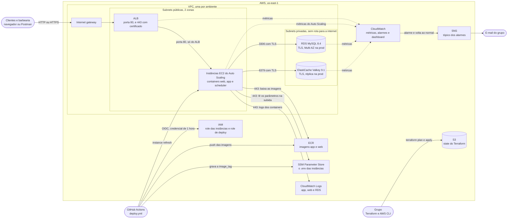

# Arquitetura do BarberFlow na nuvem

Este guia mostra como as peças do BarberFlow se encaixam na AWS: o desenho, o caminho de uma requisição, como uma versão nova chega às instâncias e onde cada peça está no código. O detalhe de cada parte fica nos outros guias de `docs/nuvem/`.

**Situação:** nada disso foi aplicado na AWS. O Terraform está validado só no código, e a homolog local roda as mesmas imagens com MySQL, Redis e Mailpit no lugar dos serviços da AWS (`docs/nuvem/DOCKER.md`).

## O desenho

| Peça | Como está | Onde está no código | Guia |
|---|---|---|---|
| Rede | Uma VPC por ambiente, 2 subnets públicas e 2 privadas em zonas diferentes, internet gateway e nenhum NAT Gateway | `terraform/network.tf` | `TERRAFORM.md`, "A rede" |
| Security groups | Cada camada só aceita a da frente: ALB (80 e 443 da internet), app (80 do ALB), banco (3306 do app) e cache (6379 do app) | `terraform/sg.tf` | `TERRAFORM.md`, "Dados e segurança" |
| ALB | Público, health check no `/up`, HTTPS com o certificado do ACM quando houver domínio | `terraform/alb.tf` | `TERRAFORM.md`, "Computação" |
| Instâncias | Auto Scaling de 1 a 4 instâncias `t3.micro` (Amazon Linux 2023), IMDSv2, disco criptografado, escala pela CPU e troca por instance refresh | `terraform/compute.tf` e `terraform/templates/user_data.sh.tftpl` | `TERRAFORM.md`, "Computação" |
| Containers | `web` (Nginx), `app` (PHP-FPM com o Laravel) e `scheduler` (agendador), com as imagens do ECR | `docker-compose.prod.yml` e `docker/php/Dockerfile` | `DOCKER.md`, "Produção na EC2" |
| Banco | RDS MySQL 8.4, privado, TLS obrigatório, backup de 7 dias e Multi-AZ na prod | `terraform/main.tf` | `TERRAFORM.md` e `BACKUP.md` |
| Cache e sessões | ElastiCache Valkey 9.1, privado, TLS e réplica com failover na prod | `terraform/cache.tf` | `TERRAFORM.md`, "Cache" |
| Configuração | Os parâmetros de `/barberflow/<ambiente>/` no SSM viram o `.env` da instância; a senha do banco e o `APP_KEY` são SecureString | `terraform/ssm.tf` | `TERRAFORM.md`, "Parâmetros do SSM" |
| Imagens | ECR com tags imutáveis, scan no push e limpeza | `terraform/ecr.tf` | `TERRAFORM.md`, "ECR" |
| Logs | Log groups `app` e `web` (driver `awslogs` do Docker) e os do RDS, 30 dias | `terraform/logs.tf` | `TERRAFORM.md`, "Logs no CloudWatch" |
| Alarmes | 12 alarmes na homolog e 15 na prod, um tópico SNS com e-mail e o dashboard | `terraform/monitoring.tf` | `TERRAFORM.md`, "Observabilidade" |
| Acesso | Session Manager, sem SSH e sem porta aberta; role das instâncias com o mínimo | `terraform/iam.tf` | `TERRAFORM.md`, "IAM" |
| Deploy | GitHub Actions entra por OIDC numa role com o mínimo: ECR, `image_tag` e instance refresh | `.github/workflows/deploy.yml` e `terraform/cicd.tf` | `CI-CD.md` |
| State | Bucket S3 versionado e criptografado, com trava | `terraform/bootstrap/` e `terraform/backend.tf` | `TERRAFORM.md`, "State remoto" |
| Custo | Orçamento mensal com aviso por e-mail | `terraform/budget.tf` | `CUSTOS.md` |

## O caminho de uma requisição

Um cliente abre `/booking` ou o Postman chama `GET /api/appointments`:

1. O endereço é o DNS do ALB (`http://barberflow-prod-alb-<número>.us-east-1.elb.amazonaws.com`) ou, com domínio, o registro CNAME que aponta para ele.
2. O ALB recebe na porta 80. Com certificado, a 80 só responde com um redirecionamento (301) para a 443, e o TLS termina no ALB. Ele descarta cabeçalhos com nome inválido e escolhe uma instância saudável do target group: as que responderam 200 no `/up` nas últimas checagens.
3. A requisição chega à porta 80 da instância, que só aceita o security group do ALB. O Nginx do container `web` entrega sozinho os arquivos de `public/` (o CSS e o JS do Vite, com cache de um ano) e manda o resto para o PHP-FPM do container `app`, na porta 9000 da rede interna do Docker.
4. O Laravel confia no `X-Forwarded-For` e no `X-Forwarded-Proto` só quando vêm da faixa da VPC (`TRUSTED_PROXIES`): é assim que ele sabe o IP do visitante (os limites por IP) e que a conexão foi em HTTPS (o cookie seguro). Ele confere o host, a sessão ou o token (Sanctum), o limite de requisições e a permissão do perfil.
5. Para responder, o Laravel lê e grava no RDS (porta 3306, com TLS e o bundle de CA da imagem) e guarda cache, sessões e as travas do agendador no Valkey (porta 6379, com TLS). Os dois ficam nas subnets privadas e só aceitam o security group do app.
6. A resposta volta pelo mesmo caminho. No caminho, o Nginx grava a linha do log de acesso (sem a query string e sem os tokens dos links) e o Laravel, os erros no stderr: o driver `awslogs` do Docker leva os dois ao CloudWatch Logs, nos grupos `web` e `app`.
7. O ALB conta a requisição, o código e o tempo de resposta da instância. São essas métricas que os alarmes de 5xx e de latência olham.

A saída das instâncias para a internet vai pelo IP público delas, sem NAT Gateway, e só nas portas 443 (ECR, SSM, CloudWatch, dnf e GitHub) e na do SMTP do provedor de e-mail. Ninguém de fora abre conexão com elas.

## Como uma versão nova chega às instâncias

1. Um push de tag `v*` na `main` dispara o `deploy.yml`, que espera a aprovação do grupo no environment `production` do GitHub.
2. O job entra na AWS por OIDC (sem chave guardada no GitHub), faz o build das imagens `app` e `web`, passa o Trivy e manda as duas para o ECR com a tag do commit.
3. Ele grava a tag no parâmetro `/barberflow/prod/image_tag` e começa o instance refresh do Auto Scaling.
4. Cada instância nova roda o `user_data`: instala o Docker e o compose (conferido por SHA-256), monta o `.env` com os parâmetros do SSM, baixa as imagens da tag e sobe os containers. O `app` roda as migrations com `--isolated`: se várias instâncias sobem juntas, só uma migra.
5. O ALB só manda tráfego para a instância nova depois de 2 respostas 200 no `/up`, e a antiga sai com 30 s para terminar o que estava atendendo. No fim, o deploy confere o `/api/health`, que testa o banco e o cache.

O passo a passo, o rollback e a ordem com o `terraform apply` estão no `docs/nuvem/CI-CD.md` (o `docs/nuvem/DEPLOY.md` aponta cada seção).

## Homolog local e AWS

| Na AWS | Na homolog local (`docker-compose.homolog.yml`) |
|---|---|
| ALB | A porta 8080 do computador, direto no `web` |
| Instâncias do Auto Scaling | Um conjunto só de `web`, `app` e `scheduler`, com as imagens de produção construídas no computador |
| RDS MySQL 8.4 | MySQL 8.4.13, sem TLS |
| ElastiCache Valkey | Redis 8.10, sem TLS |
| Provedor de e-mail | Mailpit (http://localhost:8025) |
| SSM Parameter Store | O `.env.example` mais o `docker/homolog/homolog.env` |
| CloudWatch Logs, métricas e alarmes | Loki, Prometheus e Grafana (`docs/nuvem/MONITORAMENTO.md`) |

O que só a AWS prova (OIDC, deploy, instance refresh, HTTPS no ALB, TLS do RDS e do ElastiCache, IAM mínimo, `awslogs` e os alarmes) fica validado só no código até o primeiro `apply` do grupo.
